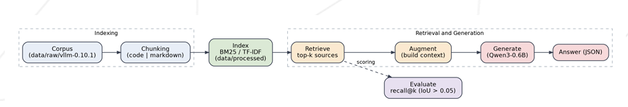

*This project has been created as part of the 42 curriculum by [dbotelho](https://github.com/sylvzzz).*

# RAG against the machine

## Description

**RAG against the machine** is a Retrieval-Augmented Generation system that
answers natural-language questions about a codebase. The target corpus is the
`vLLM` repository (`vllm-0.10.1`).

The pipeline has four stages:

1. **Index**: read the corpus, split every file into chunks, and build a
   lexical (BM25) index.
2. **Retrieve**: given a question, return the top-k most relevant source
   locations (`file_path` + character range).
3. **Generate**: feed the retrieved sources to `Qwen/Qwen3-0.6B` and produce a
   grounded answer, in the structured JSON format of the provided pydantic
   models.
4. **Evaluate**: measure retrieval quality with `recall@k`.

The goal is a system that retrieves the *right source locations* and produces
answers *grounded* in them, with no major hallucination.

## Instructions

### Requirements

- On the 42 campus machines the deep-learning stack
  (PyTorch) plus the model weights can take several gigabytes, so the install
  and the cache must live somewhere with space (e.g. `sgoinfre`).
- [`uv`](https://docs.astral.sh/uv/) for dependency management.

### Installation on a 42 school computer

Home directories are small on 42 machines, so install and cache under
`sgoinfre`:

```bash
curl -LsSf https://astral.sh/uv/install.sh | UV_INSTALL_DIR=/sgoinfre/$(USER)/.local/bin sh

# run these from the project directory
export HF_HOME="$PWD/.cache/huggingface"
export UV_CACHE_DIR="$PWD/.cache/uv"
export PIP_CACHE_DIR="$PWD/.cache/pip"

make
```

### Installation on a personal computer

```bash
curl -LsSf https://astral.sh/uv/install.sh
make
```

`make` runs `uv sync` and installs every dependency declared in
`pyproject.toml` / `uv.lock`. The `Qwen/Qwen3-0.6B` weights are downloaded from
the Hugging Face Hub on the first run and cached under `HF_HOME`.

### Prepare the corpus

Extract `vllm-0.10.1.zip` so the corpus lives at
`data/raw/vllm-0.10.1/`.

## Commands

| Action | What it does | Arguments | Usage |
| --- | --- | --- | --- |
| `index` | Chunks the corpus and builds the BM25 index | `<max_chunk_size>` | `uv run python3 -m src index --max_chunk_size 2000` |
| `search` | Top-k sources for a single query | `<query> <k>` | `uv run python3 -m src search --query "What is this codebase about?" --k 5` |
| `search_dataset` | Runs `search` over a whole dataset and saves a `StudentSearchResults` JSON (same file name) under `--save_directory` | `<path> <int> <dir>` | `uv run python3 -m src search_dataset --dataset_path <path> --k <int> --save_directory <dir>` |
| `answer` | Answers a single query from the retrieved sources | `<query> <k>` | `uv run python3 -m src answer --query "What HTTP endpoint loads a LoRA adapter?" --k 3` |
| `answer_dataset` | Generates answers for a dataset of search results and saves a `StudentSearchResultsAndAnswer` JSON under `--save_directory` | `<path> <dir>` | `uv run python3 -m src answer_dataset --student_search_results_path <path> --save_directory <dir>` |
| `evaluate` | Computes `recall@k` of your search results against the ground truth | `<student_search_results> <dataset>` | `uv run python3 -m src evaluate --student_search_results_path <path> --dataset_path <path>` |

Convenience `make` targets wrap the dataset pipeline (see the Makefile):
`index`, `search_dataset_docs`, `search_dataset_code`, `answer_dataset_docs`,
`answer_dataset_code`, `evaluate_docs`, `evaluate_code`, `moulinette_docs`,
`moulinette_code`.

## System architecture




```

src/                  full pipeline code        
  __main__.py         application start + fire CLI
  rag.py              core class containing the CLI commands
  chunking.py         creates chunks from every codebase file (code + text)
  evaluate.py         recall@k results (score of correct sources obtained)
  qwen.py             the LLM wrapper (tokenizer + model + system prompt)
  models.py           the pydantic models exchanged between stages.
  logger.py           pretty logs (red + yellow texts)
  indexing.py         tokenizes the chunks and saves the BM25 lexical method.

api.py                the REST API bonus (allows answers/indexing via browser/api calls instead of only cli)

```

## Chunking strategy

Two distinct strategies are used, because code and prose do not break apart the
same way:

- **Text (`.txt`, `.md`)** — `langchain_text_splitters.RecursiveCharacterTextSplitter`.
- **Python (`.py`)** — the same splitter with the Python language preset.

Both use `chunk_size = --max_chunk_size` (**default 2000 characters**),
`chunk_overlap = 0` and `add_start_index = True`. The start index, combined with
the chunk length, yields the exact `first_character_index` /
`last_character_index` span recorded in each `MinimalSource`.

`chunk_size` is never pushed above 2000: the moulinette rejects any source
longer than its `max_context_length` (2000), and a single over-long source
invalidates the whole output. The reference ground-truth spans are reproduced
exactly, so the retrieval offsets line up with the expected source locations.

## Retrieval method

Retrieval is **BM25**, a classic lexical (sparse) ranking function. It is
implemented with [`bm25s`](https://github.com/xhluca/bm25s) using the **bm25l**
variant with `k1 = 1` and `b = 0.5`.

- At index time the whole corpus (all chunk contents) is tokenized and the BM25
  statistics are persisted.
- At query time the question is tokenized the same way, scored against every
  chunk, and the chunks are ranked by descending BM25 score.
- The top-k chunks with a strictly positive score are returned as source
  locations.

BM25 was chosen over TF-IDF because it handles term saturation and document
length normalisation better, which matters when the corpus mixes short code
chunks with long Markdown files. No embeddings are used (lexical retrieval
only).

## Performance analysis

All numbers measured on the reference corpus (14 399 chunks) on a CPU-only
machine:

| Requirement | Limit | Measured |
| --- | --- | --- |
| Indexing time | ≤ 5 min | **~7 s** |
| Retrieval throughput | ≤ 90 s / 200 questions | **~10 s / 200 questions** |
| Recall@5 — docs | ≥ 0.80 | **1.000** |
| Recall@5 — code | ≥ 0.50 | **1.000** |

`recall@k` is reported at `k = 1, 3, 5, 10`; on the public datasets every
question reaches `1.000` at every rank. This is partly a property of the public
sample: each ground-truth source is a byte-exact chunk of the corpus and the
questions often quote source text verbatim, which lexical BM25 matches well.
Paraphrased questions are the real test, and a lexical retriever is expected to
degrade there — which is exactly the case for a hybrid (lexical + semantic)
retriever, listed as a bonus.

Chunk size affects the trade-off: larger chunks cover more context but make the
character span coarser and risk exceeding the 2000-character limit; smaller
chunks are more precise but fragment context. The default of 2000 is the
largest allowed value and gives the best recall on the reference datasets.

## Design decisions

- **Lexical BM25 over embeddings** — faster, easier, CPU-friendly, and it already clears the recall thresholds (also because it was quicker to only install the bm25s package and im lazy).
- **`chunk_overlap = 0` + `add_start_index`** — keeps the character spans exact
  and reproducible against the ground truth.
- **Load-once, reuse** — the chunk list and the BM25 index are loaded a single
  time per process; without this, retrieval would reload the full corpus for
  every question and blow the 90 s budget.
- **System prompt** — the model receives numbered sources and is instructed to
  answer *only* from them, to minimise hallucination.
- **`enable_thinking=False`** — Qwen3 has a reasoning mode; it is disabled for
  short, grounded answers.
- **Greedy decoding** (`do_sample=False`) — deterministic and fast on CPU.
- **Structured output** — every stage reads/writes the provided pydantic models
  as JSON, so nothing is hand-parsed.
- **Paths are CLI arguments** — no input/output path is hard-coded, as the
  subject requires.

## Challenges faced

- **CPU generation is slow.** `Qwen/Qwen3-0.6B` takes tens of seconds per answer
  on CPU, so the answer stage is kept separate from retrieval, and the model is
  loaded once for a whole dataset.
- **The HTTP API reloaded the model on every request.** The `answer` endpoint
  built a fresh `Qwen()` per call, so every request after the first stalled
  while re-loading the weights. Fixed by caching the model on the `RAG`
  instance (`_load_engine`): the weights load on the first request and are then
  reused, so later requests never reload them.
- **Qwen3 "thinking" mode.** By default Qwen3 emits a long reasoning trace;
  `enable_thinking=False` is needed for concise, grounded answers.
- **Disk space on campus machines.** The model weights and the PyTorch stack are
  large, so the caches are redirected to `sgoinfre` (see Instructions).

## Example usage

```bash
# 1. build the index
make index

# 2. retrieve sources for every question of a dataset
make search_dataset_docs
# or a single query:
uv run python3 -m src search --query "Whats this codebase about?" --k 5

# 3. generate grounded answers
make answer_dataset_docs

# 4. score the retrieval
make evaluate_docs

# 5. official score (see "Running the moulinette")
make moulinette_docs

#6. start the api
```

## What does `evaluate` do?

`evaluate` does not search anything. It is only a **scoreboard**: it takes the
results your `search_dataset` produced and compares them against the correct
answers (the *ground-truth* sources), then prints how many of them you found.

### How the score is computed

For every question:

1. Take the correct source(s) from the ground-truth dataset.
2. Look at your top-k results for that question.
3. A correct source counts as **found** when one of your results points to the
   **same file** and covers **roughly the same region** of it (the character
   ranges overlap enough — we do not need an exact match, only to land in the
   right area of the right file).
4. `recall@k = found correct sources / total correct sources` for that question.
5. The final number is the **average over all questions**, reported for
   `k = 1, 3, 5, 10`.

A result in a different file never counts, which is why the file path has to be
exact.

### What the results mean

`Recall@k` is the share of correct sources you managed to retrieve within your
top `k` results.

| Score | Meaning |
| --- | --- |
| `1.000` | every correct source was retrieved within the top-k |
| `0.500` | half of the correct sources were retrieved |
| `0.000` | none of the correct sources were retrieved |

`Recall@1` is the strictest (only the very first result counts); `Recall@10` is
the most forgiving. The project thresholds are **80% on docs** and **50% on
code** at `Recall@5`.

### Example

Say a question has one correct source, `lora.md`, lines 3833–5714:

- If your **first** result is exactly that region of `lora.md`, the source is
  found within the top-1, so `Recall@1` through `Recall@10` are all `1.0`.
- If that region only shows up as your **7th** result, `Recall@5` is `0.0` but
  `Recall@10` is `1.0`.

For a dataset, the score is the average of these per-question values.

> The official score used during the defense is computed by the provided
> `moulinette`. This `evaluate` command mirrors the same idea so you can iterate
> quickly on your own, without the moulinette.

## Running the moulinette

The moulinette is the official scorer (the provided binary).

**1. Pick the binary** — pick the one for your distro and rename it to
`moulinette`:

```bash
mv moulinette-ubuntu moulinette     # or: mv moulinette-fedora moulinette
```

**2. Score your results** — the **student results come first**, the
**ground-truth `AnsweredQuestions` dataset second**:

```bash
./moulinette evaluate_student_search_results \
  data/output/search_results/UnansweredQuestions/dataset_docs_public.json \
  data/datasets/AnsweredQuestions/dataset_docs_public.json \
  --k 10 --max_context_length 2000 -t 0.8
```

| Flag | Meaning |
| --- | --- |
| `--k` | max sources per question (default 10) |
| `--max_context_length` | max context characters per source (default 2000) |
| `-t` | if set, checks Recall@5 against this value and prints `PASS`/`FAIL` |

The threshold is `-t 0.8` on docs and `-t 0.5` on code. The Makefile wraps the
whole sequence (it also runs `search_dataset` first and auto-detects the binary,
so the rename is optional there):

```bash
make search_dataset_docs && make moulinette_docs   # docs
make search_dataset_code && make moulinette_code   # code
```

The datasets live under `data/datasets/` (`UnansweredQuestions/` for the
questions, `AnsweredQuestions/` for the ground truth) and every output is scoped
by dataset under `data/output/search_results/<DatasetScope>/`, as required by
the subject.

## Local HTTP API (bonus)

Besides the CLI, the system can be driven over a small [FastAPI](https://fastapi.tiangolo.com/)
app (`api.py`), so it can be triggered by something other than the terminal. It
exposes the indexing and answering steps over HTTP.

Start the server (keep `HF_HOME` set, or the model is re-downloaded):

```bash
export HF_HOME="$PWD/.cache/huggingface"
uv run uvicorn api:app --reload
```

| Route | Method | What it does |
| --- | --- | --- |
| `/status` | GET | Health check |
| `/` | GET | Welcome message |
| `/index` | GET | (Re)build the corpus index (`?max_chunk_size=2000`) |
| `/answer` | GET | Answer a question from the index (`?prompt=...&k=5`) |

### In the browser

Everything is a `GET`, so the address bar works and the browser encodes the
spaces for you (or use the interactive docs):

- Swagger UI: `http://localhost:8000/docs`
- Status: `http://localhost:8000/status`
- Re-index: `http://localhost:8000/index`
- Answer: `http://localhost:8000/answer?prompt=How do I load a LoRA adapter?&k=3`

### With curl

Use `-G --data-urlencode` so curl encodes the prompt and you do not have to
escape spaces or `?` by hand:

```bash
curl "http://localhost:8000/status"

curl "http://localhost:8000/index?max_chunk_size=2000"

curl -G "http://localhost:8000/answer" \
  --data-urlencode "prompt=How do I load a LoRA adapter?" \
  --data-urlencode "k=3"
```

> On CPU, `Qwen/Qwen3-0.6B` loads per `answer` request (~1–2 min), which is slow
> for repeated calls. The CLI batches this by loading the model once per
> `answer_dataset` run.

## Resources

- **BM25 / Okapi BM25** — the ranking function:
  https://en.wikipedia.org/wiki/Okapi_BM25
- **bm25s** — the BM25 library used: https://github.com/xhluca/bm25s
- **langchain-text-splitters** — chunking:
  https://python.langchain.com/docs/how_to/recursive_text_splitter/
- **Qwen3-0.6B model card**:
  https://huggingface.co/Qwen/Qwen3-0.6B
- **Hugging Face Transformers**:
  https://huggingface.co/docs/transformers/
- **Python Fire** — the CLI layer: https://github.com/google/python-fire

### How AI was used

Opencode (an opensource LLM coding assistant) was used mainly to:

- type-annotate the module structure and the pydantic JSON I/O;
- write and debug the `Qwen` wrapper (chat template, `enable_thinking=False`,
  generation call) and the `recall@k` metric;
- draft this README.

